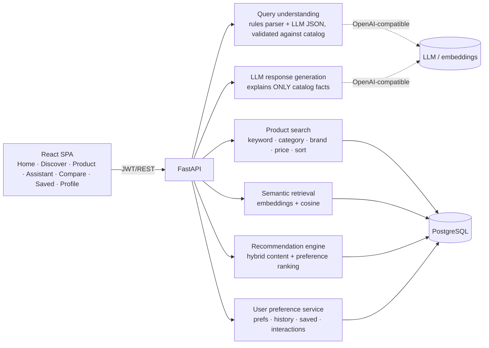

# ShopSense – Architecture

## Assistant pipeline (`POST /api/assistant`)
1. **Understand**: the rules parser extracts category, budget (₹, "k", "lakh", ranges), brands, specs ("16 gb ram") and keywords. If an LLM is configured, its JSON output is merged in **but validated**: unknown categories/brands are dropped.
2. **Constrain**: hard filters (category, price range, brands, minimum specs) are applied in SQL. The LLM never selects products.
3. **Rank**: `0.5 × semantic similarity + 0.3 × keyword coverage + 0.2 × personal score`.
4. **Explain**: each result carries deterministic reasons. The LLM, when available, rewrites them from the product JSON only, and is told not to invent specs, stock or reviews. Otherwise a template reply is used (`reply_method` tells you which).
5. Persist the turn and each recommendation (so they can be saved).

## Recommender (`app/services/recommender.py`)
`0.40 content (profile-vector cosine) + 0.20 category affinity + 0.15 brand affinity + 0.15 budget fit + 0.10 interest match`.
The profile vector is a weighted sum of embeddings of products the user viewed (1), compared (1.5), saved (3) or liked (3). Disliked products are excluded. Every non-zero component produces a human-readable reason.

## Tables
users · categories · products · user_preferences · browsing_history · saved_products (unique user+product) · product_interactions · recommendations · product_comparisons · assistant_turns
